# niri-shaders

[English](README.md) · [Українська](README.uk.md) · **日本語**

niri-shaders は、スクロール型タイリングの Wayland コンポジタ [niri](https://github.com/niri-wm/niri) に、ひとつの機能を加えたものです。どのウィンドウも、バーやドックのようなレイヤーサーフェスも、自分で書いたフラグメントシェーダーを通して描画できます。
ウィンドウルールで `.frag` ファイルを指定して保存すれば、1 秒以内にウィンドウが変わります。

<p align="center">
  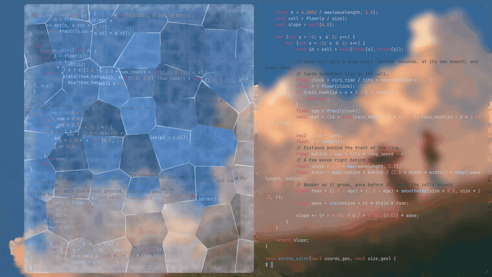
</p>

この 2 つのターミナルは `thaw` プリセットを使っています。
フォーカスのない方は氷に覆われています。
フォーカスを与えると、クリックした場所から氷が結晶ごとに溶けていきます。
閉じると一瞬で凍り、砕け散ります。
ターミナル自身はこのことを何も知りません。描いているのは niri です。

## なぜコンポジタで行うのか

プログラムは自分のウィンドウの中にしか描けず、周りのこともほとんど知りません。
コンポジタはすべてを知っているので、ここではシェーダーが自分のウィンドウについて次の情報を受け取ります。

- フォーカスを持っているか（250 ms でなめらかに変化）と、フォーカスを得てからの時間
- ウィンドウ上のポインタの位置
- ウィンドウの背後にあるもの（niri のぼかし）。背景を曲げたり、色を付けたり、凍らせたりしつつ、文字は手前にくっきり残せます
- 閉じるアニメーションの進み具合。ウィンドウを閉じるときに何かを再生できます
- サイズ、角丸、枠線、時刻、そしてウィンドウごとの乱数

これにより、ターミナルのテーマやアプリの設定では得られない効果が作れます。クリックした場所から溶ける氷、ポインタを追いかける文字の下の水、ウィンドウ全体を曲げる CRT 画面、閉じると崩れ落ちるウィンドウなどです。

## ギャラリー

<table>
  <tr>
    <td width="50%">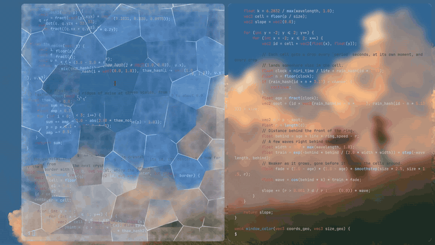<br><b>thaw</b>：ポインタは温かく、凍ったウィンドウの上ではポインタについて動く部分が溶けます。クリックするとその点からウィンドウ全体が溶けます。</td>
    <td width="50%">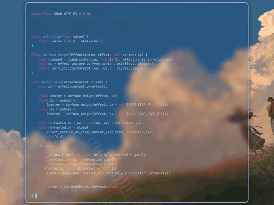<br>ShojiWM の liquid-desktop の<b>水</b>を shader pipeline で。文字の下で波がポインタを追いかけ、<code>shader-pipeline-splash</code> で石を落とせます。</td>
  </tr>
  <tr>
    <td>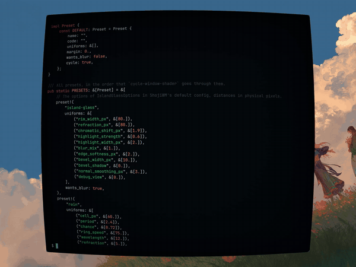<br><b>crt</b>：曲がったガラス、走査線、シャドウマスク、ビネット、ちらつき。</td>
    <td>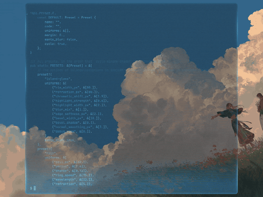<br><b>hologram</b>：流れる帯とノイズ、跳ねる行のある青い半透明ウィンドウ。</td>
  </tr>
  <tr>
    <td>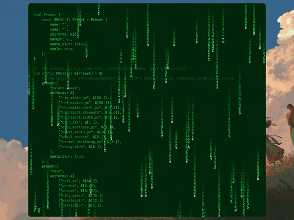<br><b>matrix</b>：緑の蛍光体と降り注ぐ文字。</td>
    <td>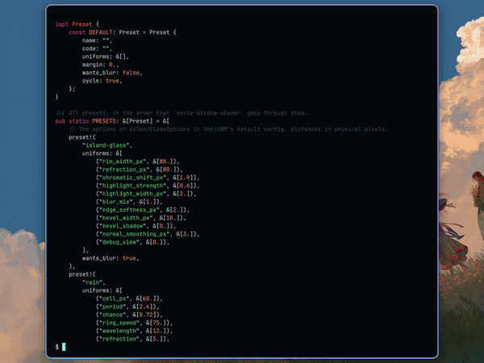<br><b>glitch</b>：数秒ごとにウィンドウが裂け、色が分かれ、ブロックが反転します。</td>
  </tr>
  <tr>
    <td><br><b>island-glass</b>：光を曲げて分散させる厚いガラスの縁。ShojiWM の island glass から。</td>
    <td>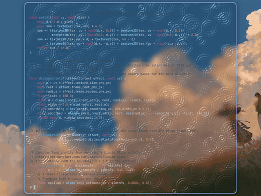<br><b>rain</b>：ターミナルの背後のぼかしたガラスに雨粒が落ち、文字の下に波紋が広がります。</td>
  </tr>
  <tr>
    <td>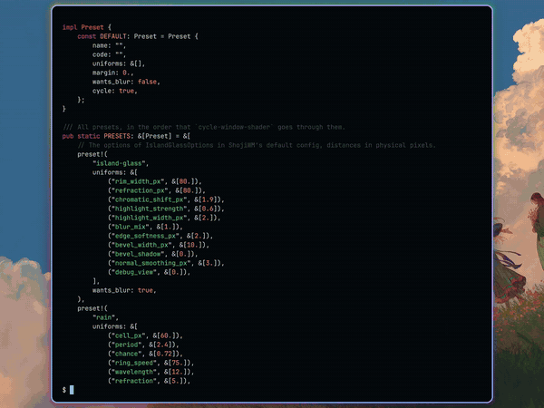<br><b>neon-edge</b>：ウィンドウの周りを走り、外側に光る虹色のリング。</td>
    <td>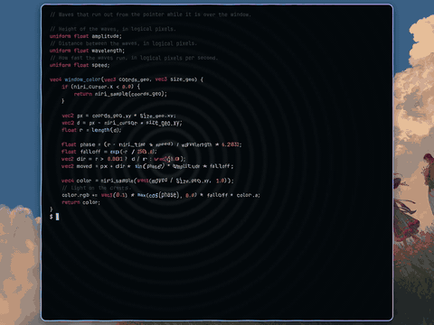<br><b>ripple</b>：ポインタからウィンドウに波が広がります。</td>
  </tr>
  <tr>
    <td>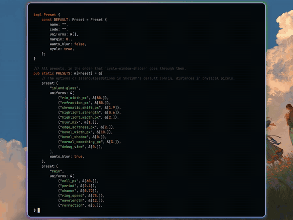<br><b>dissolve</b>：閉じるとき、ウィンドウが光るブロックに崩れます。</td>
    <td>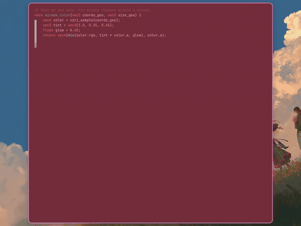<br><b>その場で編集</b>：ターミナルにシェーダーファイルが表示され、保存するたびにウィンドウが変わります。</td>
  </tr>
  <tr>
    <td>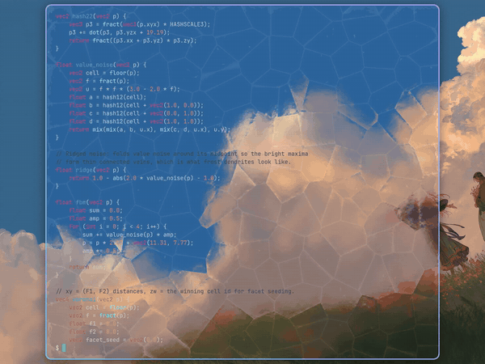<br>bea4dev さんの frozen-desktop 設定の<b>凍ったガラス</b>。元のファイルのままです。</td>
    <td>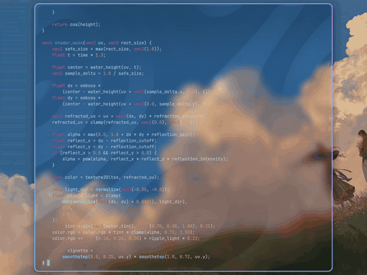<br>bea4dev さんの liquid-terminal 設定の<b>水</b>。元のファイルのままです。</td>
  </tr>
</table>

## はじめかた

niri と同じようにビルドします。

```sh
git clone https://github.com/Sileyesi/niri-shaders
cd niri-shaders
cargo build --release
# libclang がない場合は画面共有なしでビルドします:
cargo build --release --no-default-features --features dbus,systemd
```

まずは今のセッションのウィンドウの中で試せます（そこでは Mod キーは Alt です）。

```sh
examples/demo.sh ~/Pictures/some-wallpaper.png
```

普段のセッションとして使うには、niri の [Getting Started](https://niri-wm.github.io/niri/Getting-Started.html) にあるソースからのビルドの手順でインストールしてください。
niri の設定はそのまま使えます。シェーダーはその上に加えるウィンドウルールです。

```kdl
window-rule {
    match app-id="^kitty$"
    shader "preset:thaw"
}

binds {
    // フォーカス中のウィンドウでプリセットを順に切り替え、最後にルールへ戻ります。
    Mod+Shift+S { cycle-window-shader; }
}
```

ウィンドウの背後を使うシェーダーには、透けるウィンドウが必要です。たとえば kitty なら `background_opacity 0.1` です。
ターミナル、バー、ランチャーについては [docs/SHELLS.md](docs/SHELLS.md) を見てください。

## プリセット

| プリセット | 内容 | 描く対象 |
|---|---|---|
| `thaw` | フォーカスのないウィンドウに氷。フォーカスでポインタから溶け、ポインタの下も溶け、閉じると砕けます。 | 背後 |
| `island-glass` | 縁に沿った厚いレンズ。分散と光つき。 | 背後 |
| `rain` | ガラスに波紋を広げる雨粒。 | 背後 |
| `crt` | 曲がったガラス、走査線、シャドウマスク、ビネット、ちらつき。 | ウィンドウ |
| `hologram` | 青い色調、流れる帯、ノイズ、ちらつく縁。 | ウィンドウ |
| `matrix` | 緑の蛍光体と降り注ぐ文字。 | ウィンドウ |
| `glitch` | 数秒ごとに裂ける行、分かれる色、反転するブロック。 | ウィンドウ |
| `neon-edge` | ウィンドウの周りで外側に光る虹色のリング。 | ウィンドウの周り |
| `ripple` | ポインタから広がる波。 | ウィンドウ |
| `dissolve` | 閉じるとき、ウィンドウが光るブロックに崩れます。 | 閉じるとき |

背後を使うプリセットは、自分のウィンドウに niri のぼかしを自動で有効にします。
どのプリセットも設定から uniform を受け取ります。一覧は [docs/SHADERS.md](docs/SHADERS.md#presets) にあり、[`resources/shaders/`](resources/shaders/) のソースは自作の出発点にちょうどよいでしょう。

## 自分のシェーダー

シェーダーは関数がひとつだけの GLSL ES 1.00 です。
次の例は、フォーカス中のウィンドウはカラーのまま、ほかはグレーにします。切り替えは niri が `niri_focused` に与える 250 ms のフェードです。

```glsl
vec4 window_color(vec3 coords_geo, vec3 size_geo) {
    vec4 color = niri_sample(coords_geo);
    float gray = dot(color.rgb, vec3(0.3, 0.59, 0.11));
    return vec4(mix(vec3(gray), color.rgb, niri_focused), color.a);
}
```

```kdl
window-rule {
    shader "~/.config/niri/shaders/gray-unfocused.frag"
}
```

ファイルを保存すると、すべてのウィンドウが変わります。
コンパイルできない場合、ウィンドウはシェーダーがないものとして描かれ、`niri msg window-shader list` に行と列つきでコンパイラのエラーが表示されます。
[`shaders/template.frag`](shaders/template.frag) にはすべての uniform がコメントで書かれていて、[docs/SHADERS.md](docs/SHADERS.md#writing-a-shader) で詳しく説明しています。

## ShojiWM のシェーダー

bea4dev さんの [ShojiWM](https://github.com/bea4dev/ShojiWM) は TypeScript で設定するコンポジタで、シェーダーによる効果がたくさんあります。
そのシェーダーはここでそのまま動きます。niri はエントリポイントで形式を判別します。
ShojiWM の設定にあるターミナル背後の liquid glass のように、背後を使う効果は `input "backdrop"` で背後を受け取ります。

```kdl
window-rule {
    match app-id="^kitty$"
    background-effect {
        blur true
    }
    shader "~/shojiwm/liquid-glass.frag" {
        input "backdrop"
        uniform "glass_radius_px" 10.0
    }
}
```

[`examples/shojiwm-configs/`](examples/shojiwm-configs/) では bea4dev さんの 5 つの設定（rainy-terminal、liquid-terminal、frozen-desktop、liquid-desktop、true-liquid-glass）を niri で動かせます。

## シェーダーパイプライン

複数のパスが必要で、前のフレームを覚えておく効果もあります。波が動き続ける水などです。
レイヤールールやウィンドウルールの `shader-pipeline` は、フレームをまたいで内容を保つテクスチャに何度かパスを走らせ、最後にサーフェスを描きます。

```kdl
layer-rule {
    match layer="background"
    shader-pipeline {
        state "flow" scale=0.5
        pass "water-flow.frag" target="flow" repeat=4
        draw "water-surface.frag" {
            texture "flow" from="flow"
            texture "sharp" from="surface"
        }
    }
}
```

niri は ShojiWM の水に必要なもの、つまりウィンドウとポインタ、そしてそれらの動きをパスに渡します。
詳しくは [docs/SHADERS.md](docs/SHADERS.md#shader-pipelines) を見てください。

## その場でシェーダーを変える

```sh
niri msg window-shader set crt                  # フォーカス中のウィンドウ
niri msg window-shader set --id 12 ./my.frag    # `niri msg windows` の id で指定したウィンドウ
niri msg window-shader clear                    # ウィンドウルールに戻す
niri msg window-shader list                     # プリセットと、シェーダーを持つすべてのウィンドウ
```

## デスクトップ一式

[niri-showcase](https://github.com/Sileyesi/niri-showcase) は、このフォークで作った完全なデスクトップです。液体ガラスの上の QuickShell のバー、ドック、ランチャー、コントロールセンター、背後に水のあるターミナル、そしてシェーダーで描かれたウィンドウでいっぱいのワークスペースがあります。
ディスプレイマネージャのセッションとしてインストールすることも、入れ子で動かすこともできます。

## 動画

| | |
|---|---|
| [thaw.mp4](docs/media/thaw.mp4) | 凍った 2 つのターミナルの間でフォーカスが移り、最後に両方を閉じます。 |
| [thaw-pointer.mp4](docs/media/thaw-pointer.mp4) | ポインタが氷を溶かし、クリックでウィンドウ全体が溶けます。 |
| [water-pointer.mp4](docs/media/water-pointer.mp4) | ポインタを追うターミナル背後の水と、落とした石。 |
| [ripple.mp4](docs/media/ripple.mp4) | ポインタからの波。 |
| [presets.mp4](docs/media/presets.mp4) | `crt`、`hologram`、`matrix`、`glitch`、`neon-edge`、閉じるときの `dissolve`。 |
| [glass.mp4](docs/media/glass.mp4) | 透けるターミナルの上の `island-glass` と `rain`。 |
| [shojiwm.mp4](docs/media/shojiwm.mp4) | bea4dev さんの ShojiWM 設定の凍ったガラスと水。 |
| [live-edit.mp4](docs/media/live-edit.mp4) | 表示中のウィンドウのシェーダーを編集します。 |

## 現状

このフォークは 2026 年 11 月のハッカソンで、niri の main ブランチから始まりました。
niri のテストに通り、普段使いのセッションとして動いていますが、まだ若いプロジェクトなので荒削りな部分があります。
シェーダーのないウィンドウは niri とまったく同じに描かれます。
アニメーションするシェーダーを持つウィンドウは、Radeon RX 6750 XT で 1 フレームあたり 1 ミリ秒を大きく下回る GPU 時間しか使いません。内蔵グラフィックスではまだ測っていません。
まだできないことは [docs/SHADERS.md](docs/SHADERS.md#limits) にあります。

## クレジット

- [niri](https://github.com/niri-wm/niri)：YaLTeR さんとコントリビューターの皆さん。このフォークと同じく GPL-3.0-or-later です。
- [ShojiWM](https://github.com/bea4dev/ShojiWM)：bea4dev さん、MIT。`island-glass` と `dissolve` のプリセットは、ヘッダーに書いてあるとおり ShojiWM のシェーダーをもとにしています。
- `examples/shojiwm-configs/` のシェーダーは bea4dev さんの ShojiWM 設定からのもので、ライセンスがありません。[NOTICE](examples/shojiwm-configs/NOTICE.md) を見てください。

niri 自体については [英語の README](README.md) と [niri の wiki](https://niri-wm.github.io/niri/) を見てください。
