# niri-shaders

**English** · [Українська](README.uk.md) · [日本語](README.ja.md)

niri-shaders is [niri](https://github.com/niri-wm/niri), the scrollable-tiling Wayland compositor, with one thing added: any window, and any layer surface like a bar or a dock, can be drawn through a fragment shader you write.
Point a window rule at a `.frag` file, save the file, and the window changes within a second.

<p align="center">
  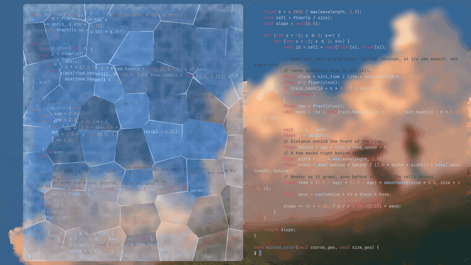
</p>

These two terminals use the `thaw` preset.
The one without the focus is covered in ice.
Give it the focus and the ice melts away, crystal by crystal, from where you clicked.
Close it and it freezes at once, then shatters.
The terminal knows nothing about any of this: niri draws it.

## Why in the compositor

A program can only draw inside its own window, and it knows little about what's around it.
The compositor knows everything, so here a shader gets, for its window:

- whether it has the focus (eased over 250 ms), and how long ago it got it;
- where the pointer is over it;
- what's behind it, as niri's blur, so it can bend, tint or freeze the background and leave the text sharp on top;
- how far its close animation has gone, so something can play when the window closes;
- its size, its rounded corners and its border, the time, and a random number of its own.

With that you get effects no terminal theme or app setting can give you: ice that melts where you click, water behind the text that follows the pointer, a CRT screen that bends the whole window, a window that falls apart when you close it.

## Gallery

<table>
  <tr>
    <td width="50%">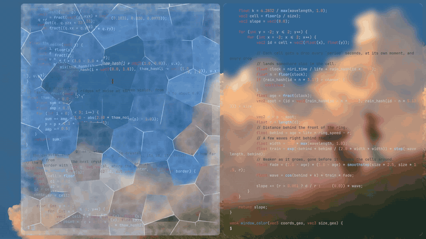<br><b>thaw</b>: the pointer is warm. Over a frozen window it melts a spot that follows it, and a click melts the whole window from that point.</td>
    <td width="50%">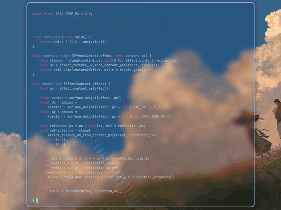<br><b>Water</b> from ShojiWM's liquid-desktop, as a shader pipeline: waves trail the pointer behind the text, and <code>shader-pipeline-splash</code> drops a stone.</td>
  </tr>
  <tr>
    <td>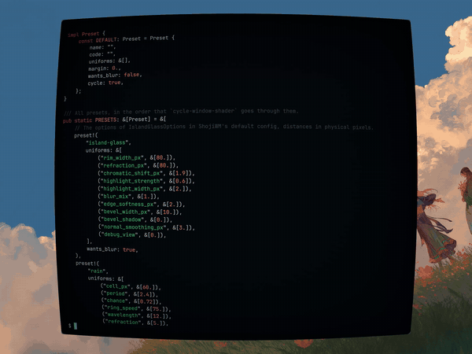<br><b>crt</b>: curved glass, scanlines, a shadow mask, vignette and flicker.</td>
    <td>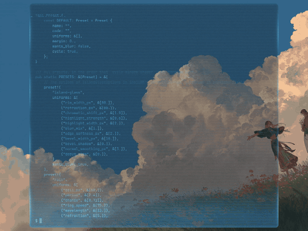<br><b>hologram</b>: a blue see-through window with running bands, noise and rows that jump.</td>
  </tr>
  <tr>
    <td>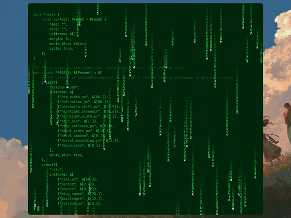<br><b>matrix</b>: green phosphor with falling characters.</td>
    <td>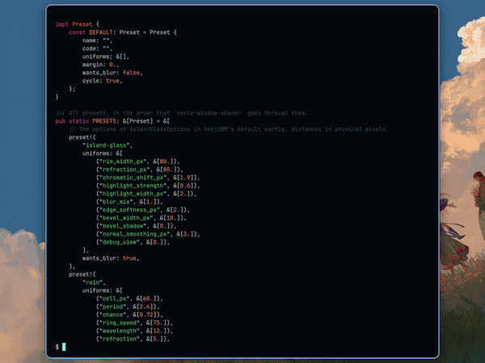<br><b>glitch</b>: every few seconds the window tears, splits its colors and inverts blocks.</td>
  </tr>
  <tr>
    <td><br><b>island-glass</b>: a thick glass rim that bends and splits the light, from ShojiWM's island glass.</td>
    <td>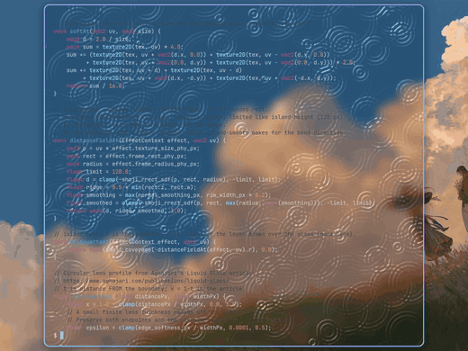<br><b>rain</b>: drops land on the blurred glass behind the terminal and ring out under the text.</td>
  </tr>
  <tr>
    <td>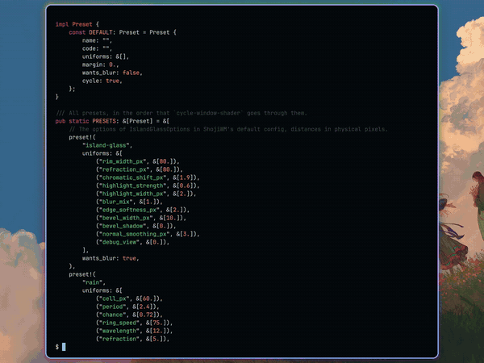<br><b>neon-edge</b>: a rainbow ring that runs around the window and glows outward.</td>
    <td>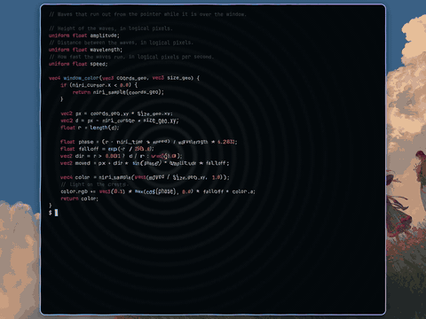<br><b>ripple</b>: waves run out from the pointer across the window.</td>
  </tr>
  <tr>
    <td>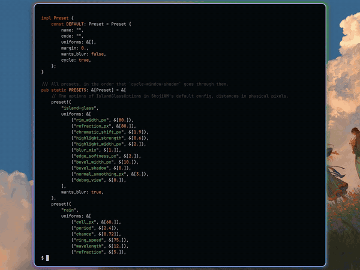<br><b>dissolve</b>: on closing, the window falls apart into glowing blocks.</td>
    <td>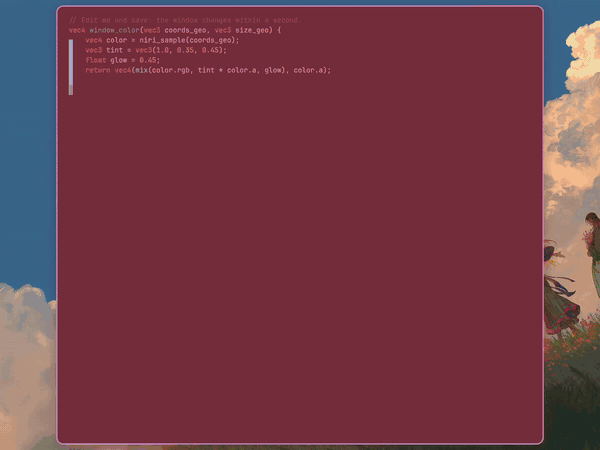<br><b>Live editing</b>: the terminal shows the shader file, and every save changes the window.</td>
  </tr>
  <tr>
    <td>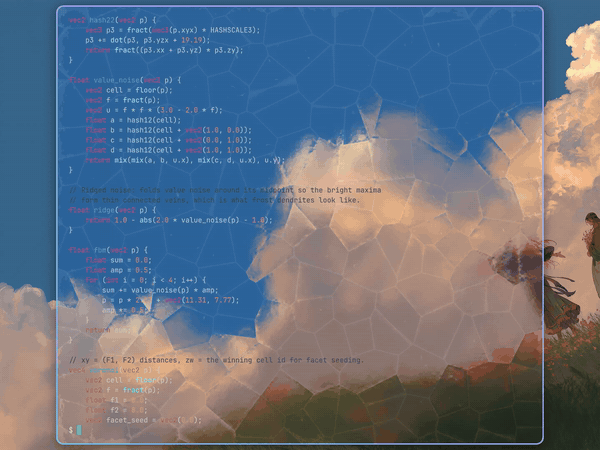<br><b>Frozen glass</b> from bea4dev's frozen-desktop config, the original file.</td>
    <td>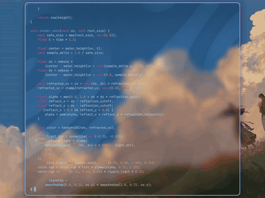<br><b>Water</b> from bea4dev's liquid-terminal config, the original file.</td>
  </tr>
</table>

## Getting started

Build it like niri:

```sh
git clone https://github.com/Sileyesi/niri-shaders
cd niri-shaders
cargo build --release
# Without libclang, build without screencasting:
cargo build --release --no-default-features --features dbus,systemd
```

Try it in a window of your current session first (there the Mod key is Alt):

```sh
examples/demo.sh ~/Pictures/some-wallpaper.png
```

To use it as your session, install it the way niri's [Getting Started](https://niri-wm.github.io/niri/Getting-Started.html) describes for a build from source.
Your niri config works as it is; the shaders are new window rules on top of it:

```kdl
window-rule {
    match app-id="^kitty$"
    shader "preset:thaw"
}

binds {
    // Goes through the presets on the focused window, then back to the rules.
    Mod+Shift+S { cycle-window-shader; }
}
```

Shaders that work over what's behind a window need a see-through window, for example kitty with `background_opacity 0.1`.
[docs/SHELLS.md](docs/SHELLS.md) covers terminals, bars and launchers.

## Presets

| Preset | What it does | Draws over |
|---|---|---|
| `thaw` | Ice on windows out of focus; the focus melts it from the pointer, the pointer melts a spot, closing shatters it. | what's behind |
| `island-glass` | A thick lens along the edge with dispersion and light. | what's behind |
| `rain` | Raindrops ringing on the glass. | what's behind |
| `crt` | Curved glass, scanlines, shadow mask, vignette, flicker. | the window |
| `hologram` | Blue tint, running bands, noise, flickering edges. | the window |
| `matrix` | Green phosphor with falling characters. | the window |
| `glitch` | Torn rows, split colors and inverted blocks every few seconds. | the window |
| `neon-edge` | A rainbow ring around the window that glows outward. | around the window |
| `ripple` | Waves running out from the pointer. | the window |
| `dissolve` | The window falls apart into glowing blocks when it closes. | on closing |

The presets that draw over what's behind turn on niri's blur for their window by themselves.
Every preset takes uniforms from the config, listed in [docs/SHADERS.md](docs/SHADERS.md#presets), and its source in [`resources/shaders/`](resources/shaders/) is a good start for your own.

## Your own shader

A shader is GLSL ES 1.00 with one function.
This one leaves the focused window in color and turns the others gray, with the 250 ms fade that niri gives `niri_focused`:

```glsl
vec4 window_color(vec3 coords_geo, vec3 size_geo) {
    vec4 color = niri_sample(coords_geo);
    float gray = dot(color.rgb, vec3(0.3, 0.59, 0.11));
    return vec4(mix(vec3(gray), color.rgb, niri_focused), color.a);
}
```

```kdl
window-rule {
    shader "~/.config/niri/shaders/gray-unfocused.frag"
}
```

Save the file and every window changes.
If it doesn't compile, the windows are drawn as if it weren't there, and `niri msg window-shader list` shows the compiler error with its line and column.
[`shaders/template.frag`](shaders/template.frag) has every uniform in a comment, and [docs/SHADERS.md](docs/SHADERS.md#writing-a-shader) describes them.

## Shaders from ShojiWM

[ShojiWM](https://github.com/bea4dev/ShojiWM) by bea4dev is a compositor configured in TypeScript, with a lot of shader effects.
Its shaders run here unchanged: niri tells the format by the entry point.
Effects that work over what's behind the window, like the liquid glass behind terminals in ShojiWM configs, get it with `input "backdrop"`:

```kdl
window-rule {
    match app-id="^kitty$"
    background-effect {
        blur true
    }
    shader "~/shojiwm/liquid-glass.frag" {
        input "backdrop"
        uniform "glass_radius_px" 10.0
    }
}
```

[`examples/shojiwm-configs/`](examples/shojiwm-configs/) runs five of bea4dev's configs in niri: rainy-terminal, liquid-terminal, frozen-desktop, liquid-desktop and true-liquid-glass.

## Shader pipelines

Some effects need more than one pass and remember what happened in the previous frames, like water that waves keep moving through.
A `shader-pipeline` in a layer rule or a window rule runs several passes into textures that keep their contents between frames, then draws the surface:

```kdl
layer-rule {
    match layer="background"
    shader-pipeline {
        state "flow" scale=0.5
        pass "water-flow.frag" target="flow" repeat=4
        draw "water-surface.frag" {
            texture "flow" from="flow"
            texture "sharp" from="surface"
        }
    }
}
```

niri feeds the passes what ShojiWM's water needs: the windows, the pointer and how they move.
See [docs/SHADERS.md](docs/SHADERS.md#shader-pipelines).

## Changing shaders on the fly

```sh
niri msg window-shader set crt                  # the focused window
niri msg window-shader set --id 12 ./my.frag    # a window by its id from `niri msg windows`
niri msg window-shader clear                    # back to the window rules
niri msg window-shader list                     # the presets, and every window with a shader
```

## A whole desktop

[niri-showcase](https://github.com/Sileyesi/niri-showcase) is a complete desktop built on this fork: a QuickShell bar, dock, launcher and control center on liquid glass, terminals with water behind them, and workspaces full of windows drawn through shaders.
It installs as a session for the display manager or runs nested.

## Videos

| | |
|---|---|
| [thaw.mp4](docs/media/thaw.mp4) | The focus moves between two frozen terminals, then both close. |
| [thaw-pointer.mp4](docs/media/thaw-pointer.mp4) | The pointer melts the ice, clicks melt whole windows. |
| [water-pointer.mp4](docs/media/water-pointer.mp4) | Water behind a terminal that follows the pointer, with stones. |
| [ripple.mp4](docs/media/ripple.mp4) | Waves from the pointer. |
| [presets.mp4](docs/media/presets.mp4) | `crt`, `hologram`, `matrix`, `glitch`, `neon-edge`, and `dissolve` on closing. |
| [glass.mp4](docs/media/glass.mp4) | `island-glass` and `rain` over a see-through terminal. |
| [shojiwm.mp4](docs/media/shojiwm.mp4) | Frozen glass and water from bea4dev's ShojiWM configs. |
| [live-edit.mp4](docs/media/live-edit.mp4) | A shader edited while the window shows it. |

## Status

The fork started at a hackathon in November 2026, from niri's main branch.
It passes niri's tests and runs as a daily session, but it's young, so expect rough edges.
Windows without a shader are drawn exactly as in niri.
A window with an animated shader costs well under a millisecond of GPU time per frame on a Radeon RX 6750 XT; integrated graphics haven't been measured yet.
What doesn't work yet is in [docs/SHADERS.md](docs/SHADERS.md#limits).

## Credits

- [niri](https://github.com/niri-wm/niri) by YaLTeR and its contributors, GPL-3.0-or-later like this fork.
- [ShojiWM](https://github.com/bea4dev/ShojiWM) by bea4dev, MIT: the `island-glass` and `dissolve` presets start from its shaders, as their headers say.
- The shaders in `examples/shojiwm-configs/` come from bea4dev's ShojiWM configs, which have no license; see [their NOTICE](examples/shojiwm-configs/NOTICE.md).

The rest of this README is niri's own.

---

<h1 align="center"></h1>
<p align="center">A scrollable-tiling Wayland compositor.</p>
<p align="center">
    <a href="https://matrix.to/#/#niri:matrix.org"></a>
    <a href="https://github.com/niri-wm/niri/blob/main/LICENSE"></a>
    <a href="https://github.com/niri-wm/niri/releases"></a>
</p>

<p align="center">
    <a href="https://niri-wm.github.io/niri/Getting-Started.html">Getting Started</a> | <a href="https://niri-wm.github.io/niri/Configuration%3A-Introduction.html">Configuration</a> | <a href="https://github.com/niri-wm/niri/discussions/325">Setup&nbsp;Showcase</a>
</p>


## About

Windows are arranged in columns on an infinite strip going to the right.
Opening a new window never causes existing windows to resize.

Every monitor has its own separate window strip.
Windows can never "overflow" onto an adjacent monitor.

Workspaces are dynamic and arranged vertically.
Every monitor has an independent set of workspaces, and there's always one empty workspace present all the way down.

The workspace arrangement is preserved across disconnecting and connecting monitors where it makes sense.
When a monitor disconnects, its workspaces will move to another monitor, but upon reconnection they will move back to the original monitor.

## Features

- Built from the ground up for scrollable tiling
- [Dynamic workspaces](https://niri-wm.github.io/niri/Workspaces.html) like in GNOME
- An [Overview](https://github.com/user-attachments/assets/379a5d1f-acdb-4c11-b36c-e85fd91f0995) that zooms out workspaces and windows
- Built-in screenshot UI
- Monitor and window screencasting through xdg-desktop-portal-gnome
    - You can [block out](https://niri-wm.github.io/niri/Configuration%3A-Window-Rules.html#block-out-from) sensitive windows from screencasts
    - [Dynamic cast target](https://niri-wm.github.io/niri/Screencasting.html#dynamic-screencast-target) that can change what it shows on the go
- [Touchpad](https://github.com/niri-wm/niri/assets/1794388/946a910e-9bec-4cd1-a923-4a9421707515) and [mouse](https://github.com/niri-wm/niri/assets/1794388/8464e65d-4bf2-44fa-8c8e-5883355bd000) gestures
- Group windows into [tabs](https://niri-wm.github.io/niri/Tabs.html)
- Configurable layout: gaps, borders, struts, window sizes
- [Gradient borders](https://niri-wm.github.io/niri/Configuration%3A-Layout.html#gradients) with Oklab and Oklch support
- [Background blur](https://niri-wm.github.io/niri/Window-Effects.html) for windows and layer-shell surfaces
- [Animations](https://github.com/niri-wm/niri/assets/1794388/ce178da2-af9e-4c51-876f-8709c241d95e) with support for [custom shaders](https://github.com/niri-wm/niri/assets/1794388/27a238d6-0a22-4692-b794-30dc7a626fad)
- Live-reloading config
- Works with [screen readers](https://niri-wm.github.io/niri/Accessibility.html)

## Video Demo

https://github.com/niri-wm/niri/assets/1794388/bce834b0-f205-434e-a027-b373495f9729

Also check out these videos that showcase a lot of the niri functionality:

- [Niri Is My New Favorite Wayland Compositor](https://www.youtube.com/watch?v=DeYx2exm04M) by Brodie Robertson
- [How Is niri This Good? Live Demo + Config](https://www.youtube.com/watch?v=7XmD5UyyhZQ) by Nick Janetakis

## Status

Niri is stable for day-to-day use and does most things expected of a Wayland compositor.
Many people are daily-driving niri, and are happy to help in our [Matrix channel].

Give it a try!
Follow the instructions on the [Getting Started](https://niri-wm.github.io/niri/Getting-Started.html) page.
Grab a desktop shell like [Dux Modular Shell] or [Noctalia] (or build a more traditional setup): niri by itself is not a complete desktop environment.
Also check out [awesome-niri], a list of niri-related links and projects.

Here are some points you may have questions about:

- **Multi-monitor**: yes, a core part of the design from the very start. Mixed DPI works.
- **Fractional scaling**: yes, plus all niri UI stays pixel-perfect.
- **NVIDIA**: seems to work fine.
- **Floating windows**: yes, starting from niri 25.01.
- **Input devices**: niri supports tablets, touchpads, and touchscreens.
You can map the tablet to a specific monitor, or use [OpenTabletDriver].
We have touchpad gestures, but no touchscreen gestures yet.
- **Wlr protocols**: yes, we have most of the important ones like layer-shell, gamma-control, screencopy.
You can check on [wayland.app](https://wayland.app) at the bottom of each protocol's page.
- **Performance**: while I run niri on beefy machines, I try to stay conscious of performance.
I've seen someone use it fine on an Eee PC 900 from 2008, of all things.
- **Xwayland**: [integrated](https://niri-wm.github.io/niri/Xwayland.html#using-xwayland-satellite) via xwayland-satellite starting from niri 25.08.

## Media

[niri: Making a Wayland compositor in Rust](https://youtu.be/Kmz8ODolnDg?list=PLRdS-n5seLRqrmWDQY4KDqtRMfIwU0U3T) · *December 2024*

My talk from the 2024 Moscow RustCon about niri, and how I do randomized property testing and profiling, and measure input latency.
The talk is in Russian, but I prepared full English subtitles that you can find in YouTube's subtitle language selector.

[An interview with Ivan, the developer behind Niri](https://www.trommelspeicher.de/podcast/special_the_developer_behind_niri) · *June 2025*

An interview by a German tech podcast Das Triumvirat (in English).
We talk about niri development and history, and my experience building and maintaining niri.

[A tour of the niri scrolling-tiling Wayland compositor](https://lwn.net/Articles/1025866/) · *July 2025*

An LWN article with a nice overview and introduction to niri.

[How to test a Wayland compositor?](https://youtu.be/w44fYK5z418?list=PLK4NE4dSsLlw) · *October 2026*

My talk about some testing techniques used in niri: property-based tests, snapshot tests, client-server tests.
The first half overlaps with my RustCon talk, the second half is new.
The talk is in Russian, but I prepared full English subtitles that you can find in YouTube's subtitle language selector.

## Contributing

If you'd like to help with niri, there are plenty of both coding- and non-coding-related ways to do so.
See [CONTRIBUTING.md](https://github.com/niri-wm/niri/blob/main/CONTRIBUTING.md) for an overview.

## Inspiration

Niri is heavily inspired by [PaperWM] which implements scrollable tiling on top of GNOME Shell.

One of the reasons that prompted me to try writing my own compositor is being able to properly separate the monitors.
Being a GNOME Shell extension, PaperWM has to work against Shell's global window coordinate space to prevent windows from overflowing.

## Tile Scrollably Elsewhere

Here are some other projects which implement a similar workflow:

- [PaperWM]: scrollable tiling on top of GNOME Shell.
- [karousel]: scrollable tiling on top of KDE.
- [scroll](https://github.com/dawsers/scroll) and [papersway]: scrollable tiling on top of sway/i3.
- Hyprland has a built-in [scrolling layout](https://wiki.hypr.land/Configuring/Layouts/Scrolling-Layout/).
- [Paneru] and [PaperWM.spoon]: scrollable tiling on top of macOS.

## Contact

Our main communication channel is a Matrix chat, feel free to join and ask a question: https://matrix.to/#/#niri:matrix.org

We also have a community Discord server: https://discord.gg/vT8Sfjy7sx

[PaperWM]: https://github.com/paperwm/PaperWM
[waybar]: https://github.com/Alexays/Waybar
[fuzzel]: https://codeberg.org/dnkl/fuzzel
[awesome-niri]: https://github.com/niri-wm/awesome-niri
[karousel]: https://github.com/peterfajdiga/karousel
[papersway]: https://spwhitton.name/tech/code/papersway/
[Paneru]: https://github.com/karinushka/paneru
[PaperWM.spoon]: https://github.com/mogenson/PaperWM.spoon
[Matrix channel]: https://matrix.to/#/#niri:matrix.org
[OpenTabletDriver]: https://opentabletdriver.net/
[Dux Modular Shell]: https://duxlabs.dev/
[Noctalia]: https://noctalia.dev/
