# niri-shaders

[English](README.md) · **Українська** · [日本語](README.ja.md)

niri-shaders — це [niri](https://github.com/niri-wm/niri), композитор Wayland зі скролінговим тайлінгом, з однією новою можливістю: будь-яке вікно і будь-яку layer-поверхню, наприклад панель чи док, можна малювати через власний фрагментний шейдер.
Вказуєте у правилі вікна файл `.frag`, зберігаєте його, і вікно змінюється протягом секунди.

<p align="center">
  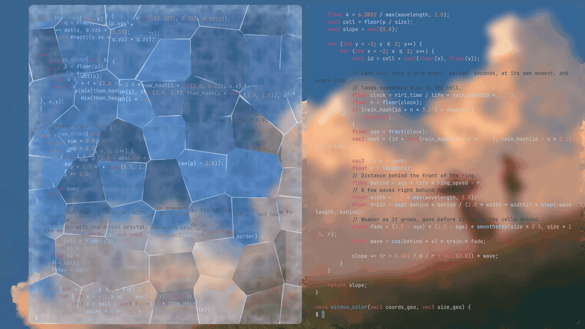
</p>

Ці два термінали використовують пресет `thaw`.
Той, що без фокусу, вкритий льодом.
Дайте йому фокус, і лід тане кристал за кристалом від місця, де ви клацнули.
Закрийте його, і він миттєво замерзає, а потім розсипається.
Сам термінал про це нічого не знає: усе це малює niri.

## Чому саме в композиторі

Програма може малювати лише у своєму вікні, і про те, що довкола, знає мало.
Композитор знає все, тож тут шейдер отримує про своє вікно:

- чи воно у фокусі (з плавним переходом за 250 мс) і як давно фокус прийшов;
- де над ним курсор;
- що за ним, у вигляді розмиття niri, тож шейдер може гнути, тонувати чи заморожувати фон, лишаючи текст чітким зверху;
- на якому етапі анімація закриття, щоб при закритті щось відбувалося;
- розмір, заокруглені кути й рамку, час і власне випадкове число.

Так виходять ефекти, яких не дасть жодна тема чи налаштування програми: лід, що тане там, де клацнули; вода під текстом, що біжить за курсором; CRT-екран, що вигинає все вікно; вікно, що розсипається, коли його закриваєш.

## Галерея

<table>
  <tr>
    <td width="50%">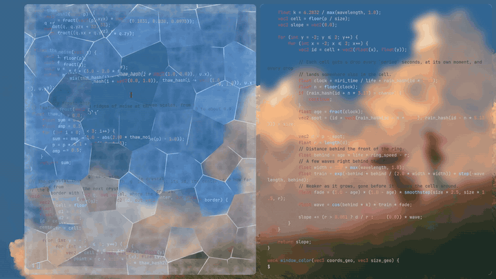<br><b>thaw</b>: курсор теплий. Над замерзлим вікном він розтоплює пляму, яка рухається за ним, а клік розтоплює все вікно від цієї точки.</td>
    <td width="50%">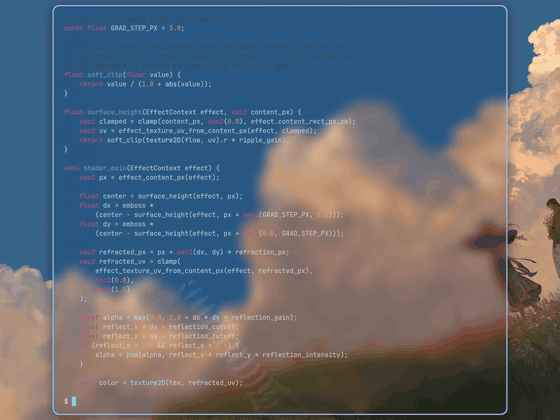<br><b>Вода</b> з liquid-desktop для ShojiWM як shader pipeline: хвилі тягнуться за курсором під текстом, а <code>shader-pipeline-splash</code> кидає камінь.</td>
  </tr>
  <tr>
    <td>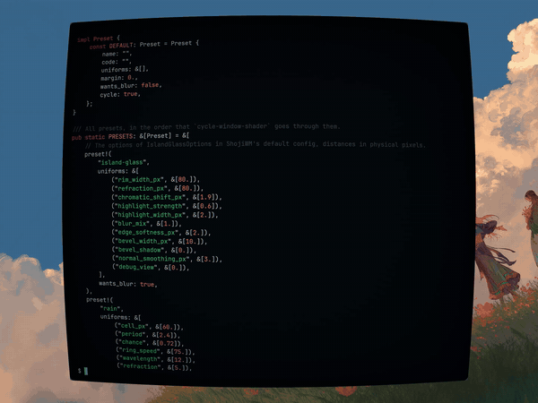<br><b>crt</b>: вигнуте скло, розгортка, тіньова маска, віньєтка й мерехтіння.</td>
    <td>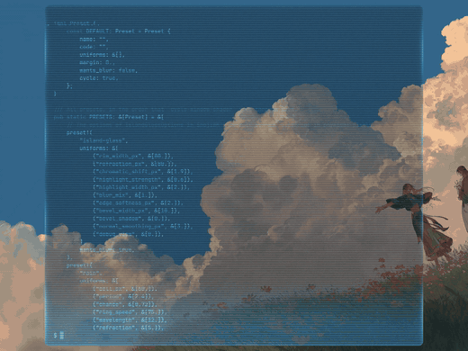<br><b>hologram</b>: синє напівпрозоре вікно зі смугами, шумом і рядками, що стрибають.</td>
  </tr>
  <tr>
    <td>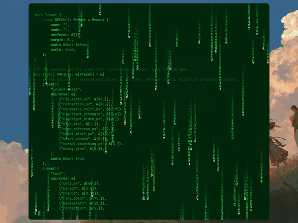<br><b>matrix</b>: зелений люмінофор і символи, що падають.</td>
    <td>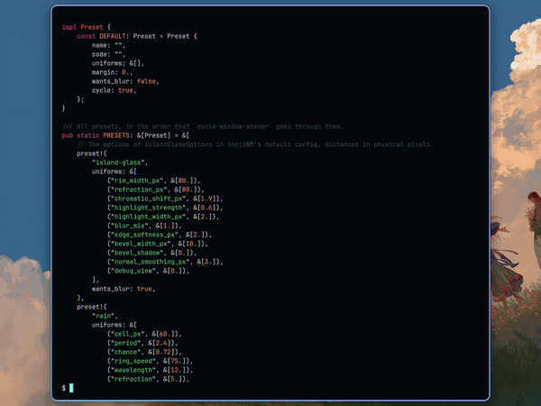<br><b>glitch</b>: що кілька секунд вікно рветься, розщеплює кольори й інвертує блоки.</td>
  </tr>
  <tr>
    <td><br><b>island-glass</b>: товстий скляний обідок, що гне й розкладає світло; з island glass у ShojiWM.</td>
    <td>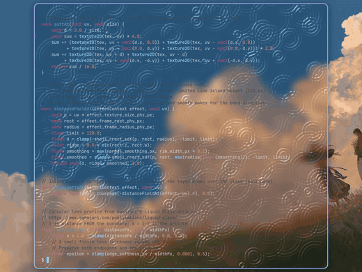<br><b>rain</b>: краплі падають на розмите скло за терміналом і розходяться колами під текстом.</td>
  </tr>
  <tr>
    <td>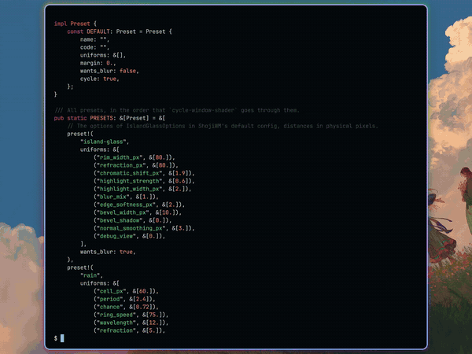<br><b>neon-edge</b>: райдужне кільце біжить довкола вікна й світиться назовні.</td>
    <td>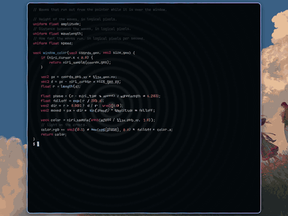<br><b>ripple</b>: від курсора по вікну розходяться хвилі.</td>
  </tr>
  <tr>
    <td>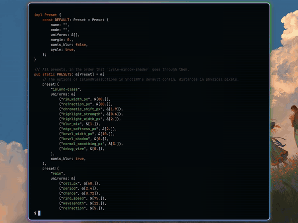<br><b>dissolve</b>: при закритті вікно розпадається на блоки, що світяться.</td>
    <td>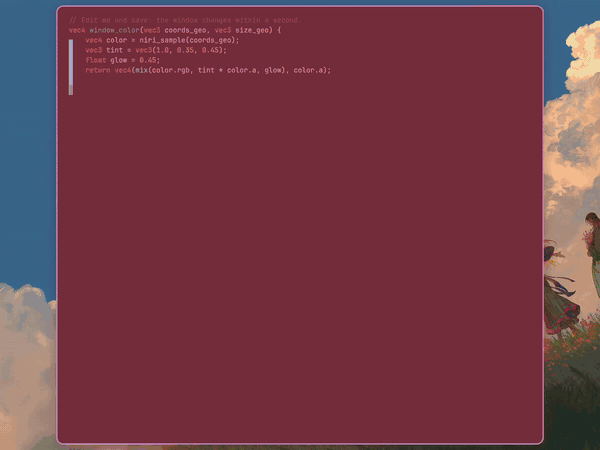<br><b>Правка наживо</b>: термінал показує файл шейдера, і кожне збереження змінює вікно.</td>
  </tr>
  <tr>
    <td>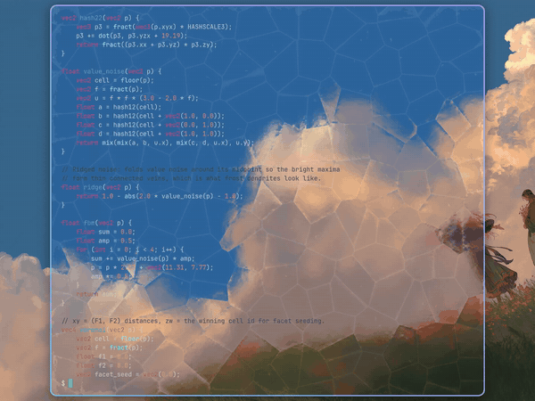<br><b>Заморожене скло</b> з конфігу frozen-desktop від bea4dev, оригінальний файл.</td>
    <td>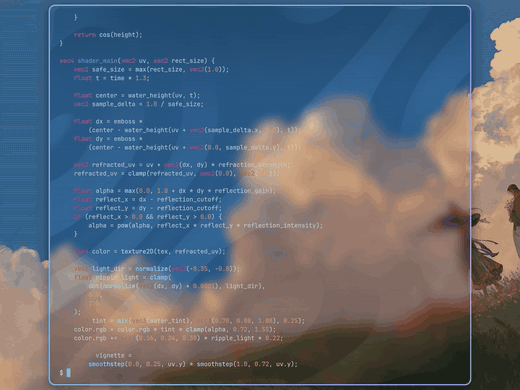<br><b>Вода</b> з конфігу liquid-terminal від bea4dev, оригінальний файл.</td>
  </tr>
</table>

## Як почати

Збирається так само, як niri:

```sh
git clone https://github.com/Sileyesi/niri-shaders
cd niri-shaders
cargo build --release
# Без libclang збирайте без запису екрана:
cargo build --release --no-default-features --features dbus,systemd
```

Спершу спробуйте у вікні поточної сесії (там клавіша Mod — це Alt):

```sh
examples/demo.sh ~/Pictures/some-wallpaper.png
```

Щоб зробити його своєю сесією, встановіть його так, як описано в [Getting Started](https://niri-wm.github.io/niri/Getting-Started.html) niri для збірки з джерел.
Ваш конфіг niri працює як є, а шейдери — це нові правила вікон поверх нього:

```kdl
window-rule {
    match app-id="^kitty$"
    shader "preset:thaw"
}

binds {
    // Перебирає пресети на вікні у фокусі, а потім повертається до правил.
    Mod+Shift+S { cycle-window-shader; }
}
```

Шейдерам, які працюють із тим, що за вікном, потрібне прозоре вікно, наприклад kitty з `background_opacity 0.1`.
Про термінали, панелі й лаунчери — у [docs/SHELLS.md](docs/SHELLS.md).

## Пресети

| Пресет | Що робить | Малює поверх |
|---|---|---|
| `thaw` | Лід на вікнах без фокусу; фокус розтоплює його від курсора, курсор розтоплює пляму, закриття розбиває вікно. | того, що за вікном |
| `island-glass` | Товста лінза по краю з дисперсією та відблиском. | того, що за вікном |
| `rain` | Краплі дощу, що розходяться колами на склі. | того, що за вікном |
| `crt` | Вигнуте скло, розгортка, тіньова маска, віньєтка, мерехтіння. | вікна |
| `hologram` | Синій відтінок, смуги, шум, мерехтливі краї. | вікна |
| `matrix` | Зелений люмінофор і символи, що падають. | вікна |
| `glitch` | Що кілька секунд розірвані рядки, розщеплені кольори й інвертовані блоки. | вікна |
| `neon-edge` | Райдужне кільце довкола вікна, що світиться назовні. | довкола вікна |
| `ripple` | Хвилі від курсора. | вікна |
| `dissolve` | Вікно розпадається на блоки, що світяться, коли закривається. | при закритті |

Пресети, що малюють поверх того, що за вікном, самі вмикають розмиття niri для свого вікна.
Кожен пресет приймає uniform-и з конфігу; їх перелічено в [docs/SHADERS.md](docs/SHADERS.md#presets), а джерела в [`resources/shaders/`](resources/shaders/) — гарна основа для власних шейдерів.

## Власний шейдер

Шейдер — це GLSL ES 1.00 з однією функцією.
Цей лишає вікно у фокусі кольоровим, а решту робить сірими, з переходом за 250 мс, який niri дає `niri_focused`:

```glsl
vec4 window_color(vec3 coords_geo, vec3 size_geo) {
    vec4 color = niri_sample(coords_geo);
    float gray = dot(color.rgb, vec3(0.3, 0.59, 0.11));
    return vec4(mix(vec3(gray), color.rgb, niri_focused), color.a);
}
```

```kdl
window-rule {
    shader "~/.config/niri/shaders/gray-unfocused.frag"
}
```

Збережіть файл, і зміняться всі вікна.
Якщо шейдер не компілюється, вікна малюються так, ніби його немає, а `niri msg window-shader list` показує помилку компілятора з рядком і стовпцем.
У [`shaders/template.frag`](shaders/template.frag) кожен uniform описано в коментарі, а [docs/SHADERS.md](docs/SHADERS.md#writing-a-shader) пояснює їх докладно.

## Шейдери з ShojiWM

[ShojiWM](https://github.com/bea4dev/ShojiWM) від bea4dev — композитор, який налаштовують на TypeScript, і в ньому багато шейдерних ефектів.
Його шейдери працюють тут без змін: niri розпізнає формат за точкою входу.
Ефекти, що працюють із тим, що за вікном, як-от liquid glass за терміналами в конфігах ShojiWM, отримують це через `input "backdrop"`:

```kdl
window-rule {
    match app-id="^kitty$"
    background-effect {
        blur true
    }
    shader "~/shojiwm/liquid-glass.frag" {
        input "backdrop"
        uniform "glass_radius_px" 10.0
    }
}
```

[`examples/shojiwm-configs/`](examples/shojiwm-configs/) запускає в niri п'ять конфігів bea4dev: rainy-terminal, liquid-terminal, frozen-desktop, liquid-desktop і true-liquid-glass.

## Shader pipelines

Деяким ефектам потрібно кілька проходів і пам'ять про попередні кадри, як воді, якою й далі біжать хвилі.
`shader-pipeline` у правилі layer-поверхні або вікна проганяє кілька проходів у текстури, що зберігають вміст між кадрами, а потім малює поверхню:

```kdl
layer-rule {
    match layer="background"
    shader-pipeline {
        state "flow" scale=0.5
        pass "water-flow.frag" target="flow" repeat=4
        draw "water-surface.frag" {
            texture "flow" from="flow"
            texture "sharp" from="surface"
        }
    }
}
```

niri передає проходам те, що потрібно воді з ShojiWM: вікна, курсор і те, як вони рухаються.
Докладніше — у [docs/SHADERS.md](docs/SHADERS.md#shader-pipelines).

## Зміна шейдерів на льоту

```sh
niri msg window-shader set crt                  # вікно у фокусі
niri msg window-shader set --id 12 ./my.frag    # вікно за id з `niri msg windows`
niri msg window-shader clear                    # назад до правил вікон
niri msg window-shader list                     # пресети й усі вікна з шейдерами
```

## Цілий робочий стіл

[niri-showcase](https://github.com/Sileyesi/niri-showcase) — готовий робочий стіл на цьому форку: панель, док, лаунчер і центр керування на QuickShell з рідким склом, термінали з водою за ними й робочі столи, повні вікон, що малюються через шейдери.
Встановлюється як сесія для менеджера входу або запускається вкладеним.

## Відео

| | |
|---|---|
| [thaw.mp4](docs/media/thaw.mp4) | Фокус переходить між двома замерзлими терміналами, потім обидва закриваються. |
| [thaw-pointer.mp4](docs/media/thaw-pointer.mp4) | Курсор розтоплює лід, кліки розтоплюють цілі вікна. |
| [water-pointer.mp4](docs/media/water-pointer.mp4) | Вода за терміналом, що біжить за курсором, і камені. |
| [ripple.mp4](docs/media/ripple.mp4) | Хвилі від курсора. |
| [presets.mp4](docs/media/presets.mp4) | `crt`, `hologram`, `matrix`, `glitch`, `neon-edge` і `dissolve` при закритті. |
| [glass.mp4](docs/media/glass.mp4) | `island-glass` і `rain` над прозорим терміналом. |
| [shojiwm.mp4](docs/media/shojiwm.mp4) | Заморожене скло й вода з конфігів ShojiWM від bea4dev. |
| [live-edit.mp4](docs/media/live-edit.mp4) | Шейдер редагується, поки вікно його показує. |

## Стан

Форк почався на хакатоні в листопаді 2026 року з головної гілки niri.
Він проходить тести niri і працює як щоденна сесія, але проєкт молодий, тож можливі шорсткості.
Вікна без шейдера малюються точнісінько як у niri.
Вікно з анімованим шейдером займає значно менше мілісекунди часу GPU на кадр на Radeon RX 6750 XT; вбудовану графіку ще не міряли.
Що поки не працює — у [docs/SHADERS.md](docs/SHADERS.md#limits).

## Подяки

- [niri](https://github.com/niri-wm/niri) від YaLTeR і контриб'юторів, GPL-3.0-or-later, як і цей форк.
- [ShojiWM](https://github.com/bea4dev/ShojiWM) від bea4dev, MIT: пресети `island-glass` і `dissolve` починаються з його шейдерів, як і сказано в їхніх заголовках.
- Шейдери в `examples/shojiwm-configs/` взято з конфігів ShojiWM від bea4dev, які не мають ліцензії; див. [їхній NOTICE](examples/shojiwm-configs/NOTICE.md).

Про сам niri — в [англійському README](README.md) і на [вікі niri](https://niri-wm.github.io/niri/).
